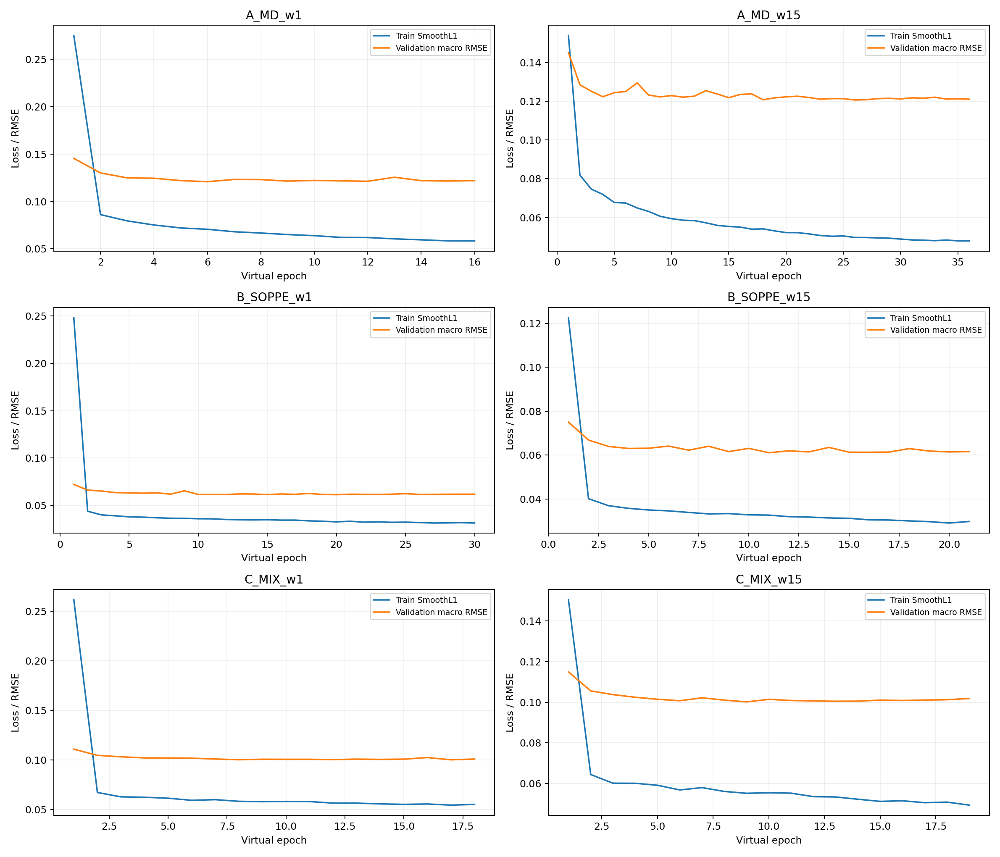
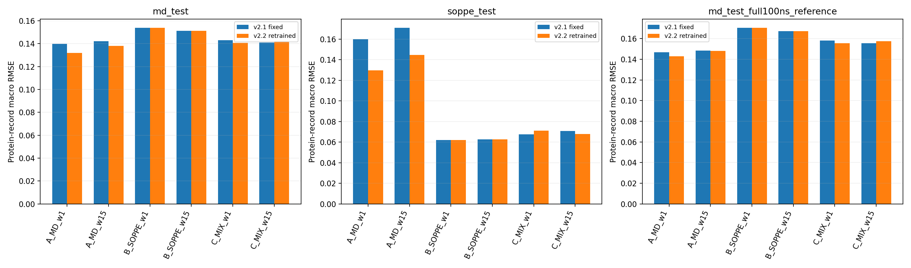
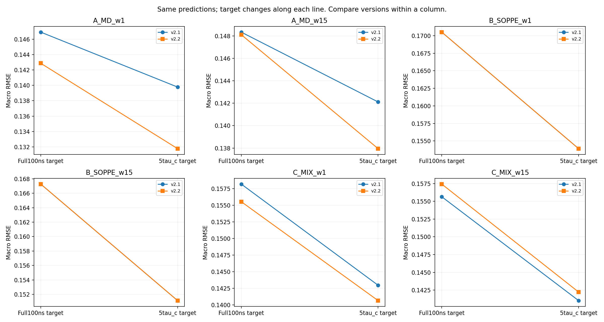
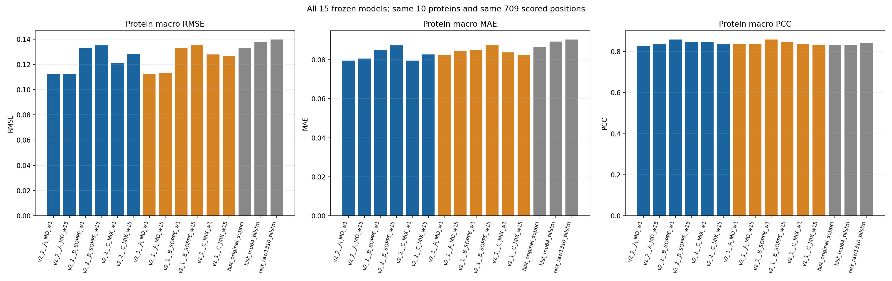

# Frozen v2.2 primary results

Protein-record macro. MD target=5τc window mean; S/experimental targets unchanged. All six routes retained.

| Endpoint | Experiment | RMSE | MAE | PCC | Spearman | Bias |
|---|---|---:|---:|---:|---:|---:|
| md_test | A_MD_w1 | 0.131770 | 0.092789 | 0.731556 | 0.742219 | 0.019568 |
| md_test | A_MD_w15 | 0.137949 | 0.096749 | 0.727799 | 0.732577 | 0.016343 |
| md_test | B_SOPPE_w1 | 0.153909 | 0.104765 | 0.685946 | 0.703346 | 0.064176 |
| md_test | B_SOPPE_w15 | 0.151129 | 0.104356 | 0.688015 | 0.708289 | 0.056765 |
| md_test | C_MIX_w1 | 0.140642 | 0.098103 | 0.725657 | 0.739772 | 0.044454 |
| md_test | C_MIX_w15 | 0.142230 | 0.097357 | 0.722074 | 0.736831 | 0.050941 |
| soppe_test | A_MD_w1 | 0.129611 | 0.089330 | 0.832851 | 0.794559 | -0.054565 |
| soppe_test | A_MD_w15 | 0.144734 | 0.100542 | 0.814371 | 0.775388 | -0.062698 |
| soppe_test | B_SOPPE_w1 | 0.062105 | 0.042158 | 0.874333 | 0.811255 | 0.014096 |
| soppe_test | B_SOPPE_w15 | 0.062678 | 0.043891 | 0.873705 | 0.811848 | 0.005396 |
| soppe_test | C_MIX_w1 | 0.071143 | 0.049901 | 0.860845 | 0.812276 | -0.004343 |
| soppe_test | C_MIX_w15 | 0.067992 | 0.048341 | 0.865416 | 0.813423 | 0.001449 |
| experimental10 | A_MD_w1 | 0.112190 | 0.079622 | 0.828290 | 0.624760 | -0.011037 |
| experimental10 | A_MD_w15 | 0.112537 | 0.080691 | 0.836154 | 0.609331 | -0.002040 |
| experimental10 | B_SOPPE_w1 | 0.133233 | 0.084767 | 0.859321 | 0.611955 | 0.031390 |
| experimental10 | B_SOPPE_w15 | 0.134917 | 0.087407 | 0.847103 | 0.620270 | 0.023233 |
| experimental10 | C_MIX_w1 | 0.120903 | 0.079508 | 0.846524 | 0.616730 | 0.014977 |
| experimental10 | C_MIX_w15 | 0.128321 | 0.082782 | 0.836436 | 0.628244 | 0.022623 |

See `primary_18_scores.tsv` for complete macro/pooled/sequence/group metrics and the model card for limits. Source checkpoint hashes in these tables refer to the original accepted bests; portable-export hashes are in `checkpoints/model_registry.json`.

## Training-loss overview

The six individual histories and all original PNG/SVG figures are preserved. SmoothL1 training loss and validation RMSE are different quantities.

## Same-target version comparison and MD2×2

Never interpret the old-model/old-target→new-model/new-target diagonal as an isolated training gain. Full100ns is an auxiliary target, not mixed into the primary ranking.

## Experimental context

All10 per-protein curves and the historical-layout-v2 figure are included. Historical references are not matched retraining; the reused experimental benchmark and overlap/statistical-resolution limits must be stated.

No model was chosen or tuned on these scores during release preparation.
